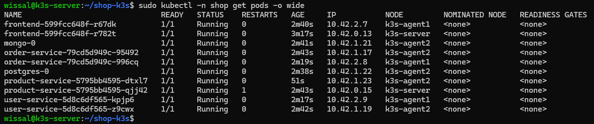
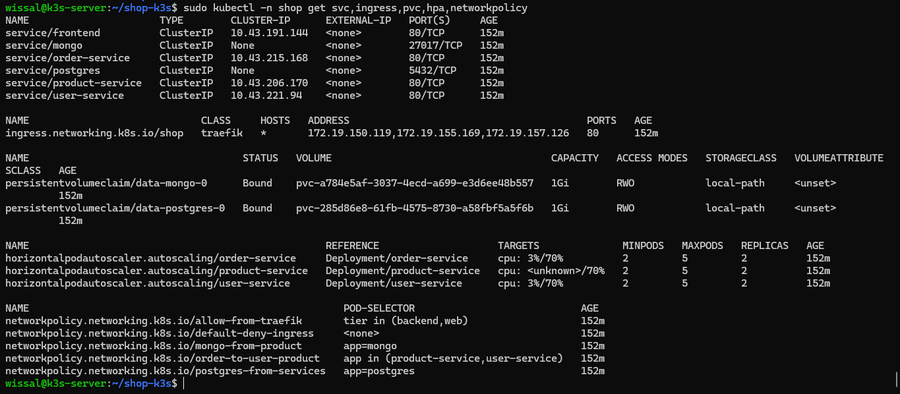
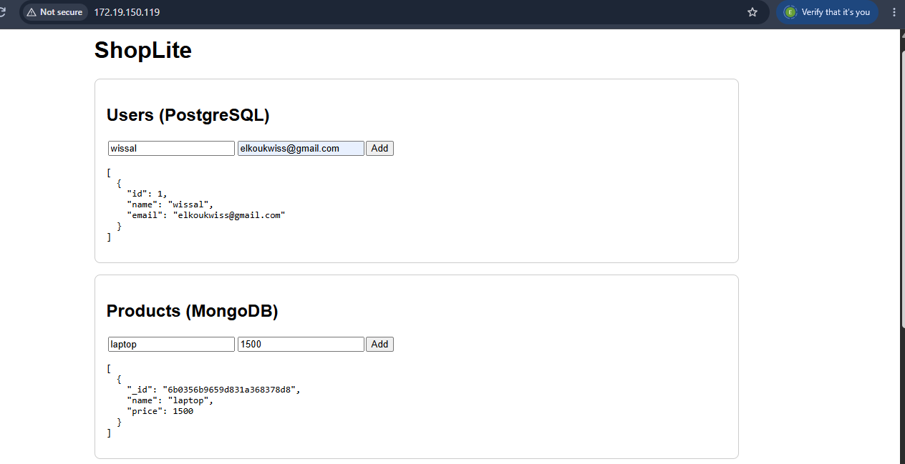
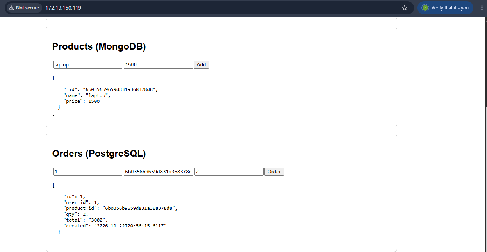
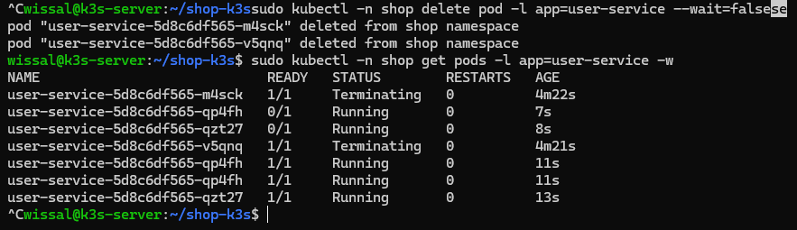
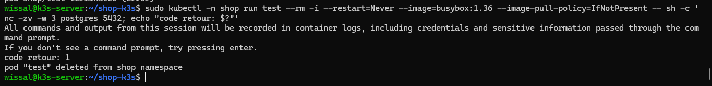
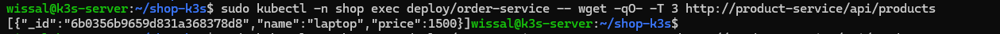
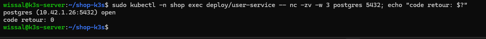
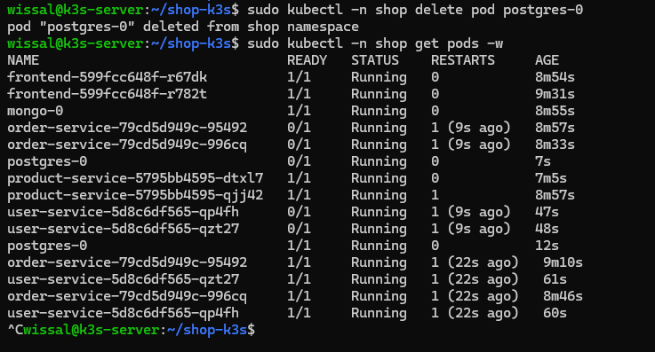
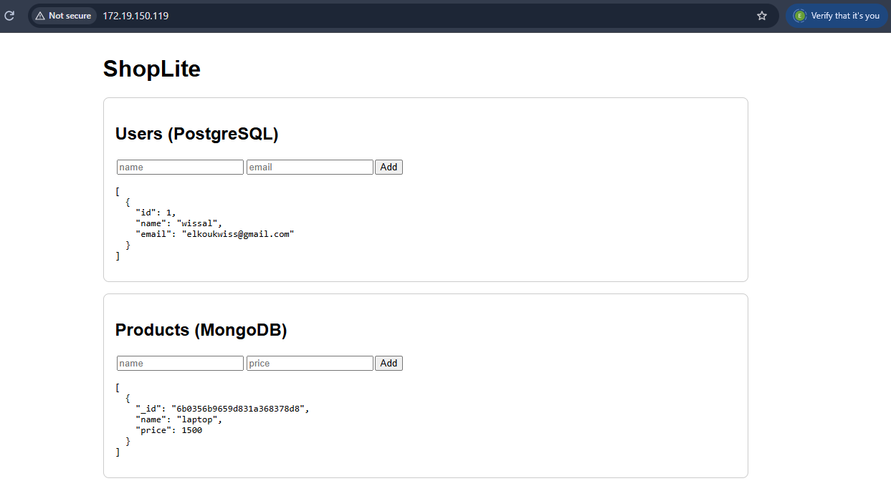

# ShopLite : application full-stack microservices sur K3s

Projet final Kubernetes : une application full-stack (front + 3 microservices + 2 types de bases de données) conteneurisée avec Docker et déployée sur un cluster **K3s** (1 master + 2 agents) en appliquant les bonnes pratiques Kubernetes.

## Architecture

```
Navigateur ─► Ingress Traefik ─┬─ /               frontend (nginx)
                               ├─ /api/users      user-service    ─► PostgreSQL (base `users`)
                               ├─ /api/products   product-service ─► MongoDB
                               └─ /api/orders     order-service   ─► PostgreSQL (base `orders`)
                                                      └─ appels REST vers user-service et product-service
```

| Composant | Technologie | Rôle |
|---|---|---|
| frontend | nginx (non-root) | Interface web (utilisateurs, produits, commandes) |
| user-service | Node.js / Express | Gestion des utilisateurs |
| product-service | Node.js / Express | Catalogue de produits |
| order-service | Node.js / Express | Commandes ; valide l'utilisateur et le produit en appelant les 2 autres services |
| postgres | PostgreSQL 16 (**SQL**) | Données utilisateurs et commandes |
| mongo | MongoDB 7 (**NoSQL**) | Données produits |

## Infrastructure

Cluster K3s sur 3 machines virtuelles Ubuntu 24.04 : `k3s-server` (control-plane), `k3s-agent1` et `k3s-agent2`.

## Structure du dépôt

```
.
├── frontend/            # index.html + Dockerfile (nginx-unprivileged)
├── services/
│   ├── user/            # server.js, package.json, Dockerfile
│   ├── product/
│   └── order/
├── k8s/                 # manifests Kubernetes (kustomize)
│   ├── 00-namespace.yaml
│   ├── 01-config-secret.yaml
│   ├── 10-postgres.yaml        # StatefulSet + PVC
│   ├── 11-mongo.yaml           # StatefulSet + PVC
│   ├── 20-user-service.yaml    # Deployment + Service + HPA
│   ├── 21-product-service.yaml
│   ├── 22-order-service.yaml
│   ├── 30-frontend.yaml        # Deployment + Service + Ingress
│   ├── 40-networkpolicies.yaml
│   └── kustomization.yaml
├── screenshots/
└── deploy.sh
```

## Déploiement

```bash
# 1. Cluster K3s
curl -sfL https://get.k3s.io | sh -                                   # master
curl -sfL https://get.k3s.io | K3S_URL=https://<IP_MASTER>:6443 \
     K3S_TOKEN=<TOKEN> sh -                                           # chaque agent

# 2. Images (Docker Hub : wissl/*)
docker build -t wissl/user-service:1.0.0    services/user
docker build -t wissl/product-service:1.0.0 services/product
docker build -t wissl/order-service:1.0.0   services/order
docker build -t wissl/frontend:1.0.0        frontend
docker push wissl/<image>:1.0.0

# 3. Déploiement
kubectl apply -k k8s/
kubectl -n shop get pods -o wide
```

L'application est accessible sur `http://<IP_MASTER>/`.

## Bonnes pratiques Kubernetes appliquées

- **Namespace dédié** (`shop`) pour isoler l'application.
- **ConfigMap et Secret** : configuration et identifiants séparés des images.
- **StatefulSet + PVC** (`local-path`) + services headless pour PostgreSQL et MongoDB : les données survivent aux redémarrages.
- **Probes** `liveness` et `readiness` sur tous les services.
- **Requests et limits** CPU/mémoire sur tous les conteneurs.
- **Haute disponibilité** : 2 replicas par service, `RollingUpdate` avec `maxUnavailable: 0`.
- **Autoscaling** : HorizontalPodAutoscaler (2 à 5 pods, cible 70 % CPU) sur les 3 microservices.
- **Sécurité des conteneurs** : exécution non-root, système de fichiers en lecture seule (services Node), `capabilities: drop ALL`, `seccompProfile: RuntimeDefault`, `allowPrivilegeEscalation: false`.
- **NetworkPolicies** : tout le trafic entrant est refusé par défaut, puis autorisé au cas par cas (Traefik vers frontend et services ; `order-service` vers `user-service` et `product-service` ; seulement `user-service` et `order-service` vers PostgreSQL ; seulement `product-service` vers MongoDB).
- **Un seul point d'entrée** : Ingress Traefik (fourni par K3s) ; tous les services sont en `ClusterIP`.
- Images **alpine** légères avec **versions épinglées**.

## Preuves de déploiement

### 1. Cluster K3s : 1 master + 2 agents (`Ready`)
```
$ sudo kubectl get nodes -o wide
NAME         STATUS   ROLES           AGE   VERSION        INTERNAL-IP      OS-IMAGE             CONTAINER-RUNTIME
k3s-agent1   Ready    <none>          21s   v1.37.2+k3s1   172.19.157.126   Ubuntu 24.04.2 LTS   containerd://2.3.7-k3s1
k3s-agent2   Ready    <none>          37m   v1.37.2+k3s1   172.19.155.169   Ubuntu 24.04.2 LTS   containerd://2.3.7-k3s1
k3s-server   Ready    control-plane   66m   v1.37.2+k3s1   172.19.150.119   Ubuntu 24.04.2 LTS   containerd://2.3.7-k3s1
```

### 2. Pods répartis sur les 3 nœuds
Les 10 pods (2 frontend, 2 par microservice, `postgres-0`, `mongo-0`) sont `Running` et `1/1`.



### 3. Services, Ingress, PVC, HPA et NetworkPolicies


### 4. Application fonctionnelle (PostgreSQL + MongoDB)
Un utilisateur (PostgreSQL), un produit (MongoDB) et une commande dont le total est calculé par `order-service` après appel aux deux autres services.




### 5. Self-healing
Les pods de `user-service` sont supprimés ; Kubernetes en recrée immédiatement de nouveaux et le service reste disponible.



### 6. NetworkPolicies
- Un pod de test quelconque n'a pas le droit de joindre PostgreSQL : connexion rejetée (code retour `1`).
- `user-service` (autorisé) joint PostgreSQL : `open` (code retour `0`).
- `order-service` joint `product-service` : réponse JSON (autorisé).
- `user-service` ne peut pas joindre `product-service` : connexion refusée.

```
$ kubectl -n shop exec deploy/user-service -- wget -qO- -T 3 http://product-service/api/products
wget: can't connect to remote host (10.43.206.170): Connection refused
```

Le contrôleur de NetworkPolicy de K3s rejette les connexions interdites au lieu de les laisser expirer.





### 7. Persistance des données
`postgres-0` est supprimé puis recréé ; les données sont toujours présentes grâce au volume persistant.




## Notes d'exploitation

- Le réseau des machines virtuelles étant lent, certains téléchargements depuis Docker Hub échouaient (`timeout awaiting response headers`). Les images ont donc aussi été chargées directement dans containerd sur chaque nœud (`docker save` puis `k3s ctr images import`) et les manifests utilisent `imagePullPolicy: IfNotPresent`.
- Les mots de passe de `k8s/01-config-secret.yaml` sont des **valeurs de démonstration**. En production, on utiliserait SealedSecrets, SOPS ou un gestionnaire de secrets externe, et jamais de secrets en clair dans Git.

## Pistes d'amélioration

- Pipeline CI/CD (GitHub Actions) pour construire et pousser les images.
- HTTPS avec cert-manager.
- Une instance PostgreSQL par microservice et réplication des bases.
- Supervision avec Prometheus et Grafana.
